# Playtest automatique — 30 octobre 2026

Campagne de nuit du bot de playtest (`tools/playtest/`, branche `chore/playtest-auto`) :
**150 raids complets, 60 combats de boss, 60 duels d'élites, simulation directe des drops,
audit des animations et captures en jeu.** Godot 4.7.2, `main` du 29/10 (bestiaire fusionné).

> **À lire avant les chiffres.** Le bot joue sans tricher, mais il joue moins bien qu'un bon
> joueur humain. Il esquive les télégraphes et recule devant la mêlée. En revanche, il ne lit
> pas les zones au sol, ne se cache pas et ne prépare pas ses combats. Les taux absolus
> (extraction, victoire) sont donc pessimistes. Les **écarts** sont fiables : entre difficultés,
> entre monstres, entre arsenaux. Pour cette raison, **aucun réglage de difficulté n'est
> appliqué** dans cette branche. Ils sont proposés, chiffrés et testés en passe B. Seule une
> règle existante du projet a été appliquée : le plafond des drops.

---

## Résumé (une page)

### Les 10 constats les plus importants, par priorité

1. **Les boss sont injustes, pas seulement difficiles : 0 victoire sur 58 combats valides.**
   On meurt en 19 s en moyenne, et presque jamais du boss. Face au Shérif, 17 morts sur 19
   viennent de son escorte et des monstres de l'arène ; face à l'Omnistore, 17 sur 18. Le boss
   finit le combat avec 90 à 100 % de ses PV. L'Architecte fait exception : il tue lui-même
   (12 morts sur 20, laser orbital et attaque). **La cible « possible mais coûteux pour un
   joueur bien équipé » n'est pas atteinte.** Même le bot le mieux armé n'entame pas le boss.
2. **Le mur de difficulté entre Facile et Normal.** Taux d'extraction du bot :
   - Station Kagami : 78 % en Facile, 0 % en Normal ;
   - Dust Creek : 22 % en Facile, 0 % en Normal.

   Normal additionne +40 % d'ennemis, des dégâts +33 %, une cadence +28 % et une précision
   nettement meilleure : environ 2,5 fois plus de pression. Or la **Station Kagami et les
   Galeries sont jouées en Normal** (difficulté propre à la carte). La 2e carte, débloquée au
   niveau 3, donne donc 0 extraction sur 12 raids pour le bot.
3. **Deux monstres causent la moitié des morts** :
   - le Téléporteur (`ss_teleporter`) : 24 morts sur 91, 17 PV perdus par rencontre ;
   - le Maraudeur (`fw_marauder`, hyène) : 21 morts sur 91. Il va aussi vite que le joueur
     (250), on ne peut pas le semer.

   L'Alien (`ss_alien`) est le plus dur par rencontre (32 PV), mais il est rare.
4. **Les élites sont mal étagées** :
   - le Drone tireur (`ss_drone_tieur`) est trivial : 10 victoires sur 10, 0 dégât reçu, mort en 3 à 5 s ;
   - la Gardienne du magasin (`mall_store_warden`) est presque imbattable : 1 victoire sur 10 ;
   - le Déserteur ne dépend que de l'arsenal : 0 sur 5 avec l'arsenal moyen, 5 sur 5 bien équipé.
5. **Deux armes « à débloquer en tuant » sont inaccessibles en pratique.** Le SCAR-H demande
   3 Robustes (`fw_bruiser`) : 2 vus et 0 tué en 150 raids. Le M202 demande le Déserteur, qui
   n'apparaît pas en raid au rez-de-chaussée. À l'inverse, le Desert Eagle (1,1 raid) et le
   M82 (0,7 raid) se débloquent presque tout de suite.
6. **Le butin du Shérif viole les plafonds par construction.** 4 à 6 tirages sans remise parmi
   une dizaine d'objets : lingot d'or 32 %, Desert Eagle 32 %, AUG Légendaire 2,5 %. Baisser
   les poids n'y peut rien. Il faut décider (voir Volet 3). Le Buffle, lui, est corrigé.
7. **Trois défauts d'interface sur les écrans de combat** (seeds dans la liste des bugs) :
   - l'écran « Éliminé » s'affiche sous le HUD : la barre du boss et les boutons restent par-dessus ;
   - le message « Nouvelle arme débloquable » chevauche le titre de la barre du boss ;
   - les répliques des ennemis se superposent aux sprites.
8. **Animations** :
   - l'Omnistore a des planches plus courtes que les autres (repos 4, course 6, mort 6, contre
     6, 8 et 8) et une mort illisible : la dernière image ressemble à la course ;
   - plusieurs paires se confondent sur téléphone : Déserteur et Shérif, les robots gris-bleu
     de la Station (Atlas, Droïde de sécurité, Gardien, Téléporteur), Écorcheur et Violent.
9. **Progression du raider (calculée sur 150 raids)** : 178 XP par raid en moyenne.
   - niveau 3 (Kagami) : 5 raids ;
   - niveau 8 (Galeries) : 34 raids ;
   - niveau 30 : environ 410 raids.

   Avec le taux d'extraction du bot, l'or rapporte 55 pièces par raid, et une arme de
   boutique de rareté Peu commun ou plus coûte 13 à 51 raids. L'économie de l'or est à revoir **après** la
   difficulté : elle en dépend directement.
10. **La technique est saine** :
    - 2 erreurs Godot sur 270 parties, le même message de rendu (`texture_storage.h:85 Parameter "t" is null`, duels seeds 7000 et 7038), et 0 avertissement ;
    - 0 conteneur inaccessible ;
    - 16 ennemis bloqués en 150 raids (5 s sur place en voulant bouger) ;
    - temps d'image moyen 1,8 ms (logique seule, headless). Un pic à 438 ms (seed 5030,
      Kagami Normal), les autres sous 190 ms.

### Réglages appliqués dans cette branche
| Fichier | Valeur | Avant → après | Pourquoi |
|---|---|---|---|
| `data/loot_tables/enemy_fw_buffalo.tres` | `raw_diamond` | 0,0015 → 0,000918 | Légendaire à 1,46 % par fouille (plafond 1 %) |
| `data/loot_tables/enemy_fw_buffalo.tres` | `treasure_map` | 0,008 → 0,006877 | Épique à 4,15 % (plafond 4 %) |

Corrigé avec `python3 tools/cap_drop_rates.py` (règle existante du projet). `--check` ne
signale plus que le Shérif (constat 6).

### Réglages testés en passe B, non appliqués
| Réglage | Avant → après | Effet mesuré | Décision |
|---|---|---|---|
| `[generator] enemy_density` (Normal, Difficile) | 0,028 / 0,036 → 0,024 / 0,031 | Extraction en Normal : 0/24 → 3/24. En Difficile : aucun effet | Recommandé, à valider par un joueur humain |
| `[enemy_difficulty] cooldown_mult` (Normal, Difficile) | 0,9 / 0,84 → 1,0 / 0,92 | (même essai que la ligne ci-dessus) | idem |
| `[enemy_difficulty] spread_mult` (Normal, Difficile) | 0,85 / 0,75 → 1,0 / 0,85 | (même essai que la ligne ci-dessus) | idem |
| `fw_marauder.tres` `move_speed` | 250 → 230 | Aucun : dégâts par rencontre 9,7 → 13,6 | **Annulé** |
| `ss_teleporter.tres` `attack_cooldown` | 0,9 → 1,1 | Aucun : 17,4 → 20,0 PV par rencontre, toujours 1er tueur | **Annulé** |

Les trois premières lignes forment un seul essai. 3 extractions sur 24 contre 0 sur 24, c'est
un signal faible (p ≈ 0,12, test de Fisher unilatéral) : pas assez pour l'appliquer seul. Le patch exact est dans
`donnees/essai_passe_B.patch`.

---

## Volet 1 — Raids complets (150)

**Protocole.** Passe A : 100 raids, Dust Creek et Station Kagami, 5 difficultés, 3 profils
(prudent, agressif, fouilleur). Les 30 combinaisons sont jouées 3 fois chacune, plus 10 raids
en Normal et en Difficile. Passe B : 50 raids avec l'essai ci-dessus, sur les combinaisons
principales (Normal, Difficile, 4 fois) plus 2 en Expert.

L'arsenal de départ dépend de la difficulté :
- Facile et Normal : débutant (P9, MP5, grenade) ;
- Difficile et Expert : moyen (M4A1, Glock 18, M24, grenade) ;
- Cauchemar : bien équipé (SCAR-H, M82, P90, C4).

Chaque raid dure au plus 7 min de jeu. Résultats bruts : `donnees/parties_A.csv` et `parties_B.csv`.

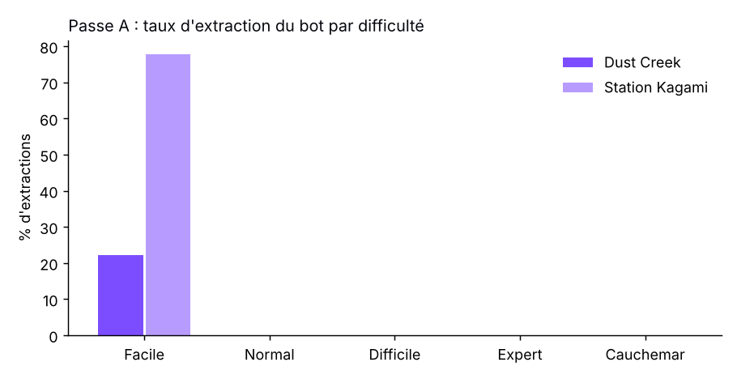

### Passe A par carte et difficulté (3 profils confondus)
| Carte | Difficulté | Raids | Extraction | Survie médiane (morts) | Ennemis tués | PV min. moyens |
|---|---|---|---|---|---|---|
| Dust Creek | Facile | 9 | 22 % | 179 s | 21,2 | 8 |
| Dust Creek | Normal | 12 | 0 % | 56 s | 12,8 | 0 |
| Dust Creek | Difficile | 11 | 0 % | 42 s | 6,6 | 0 |
| Dust Creek | Expert | 9 | 0 % | 25 s | 5,7 | 0 |
| Dust Creek | Cauchemar | 9 | 0 % | 34 s | 9,0 | 0 |
| Station Kagami | Facile | 9 | 78 % | 194 s | 26,4 | 28 |
| Station Kagami | Normal | 12 | 0 % | 221 s | 24,8 | 0 |
| Station Kagami | Difficile | 11 | 0 % | 74 s | 10,1 | 0,6 |
| Station Kagami | Expert | 9 | 0 % | 43 s | 6,6 | 0 |
| Station Kagami | Cauchemar | 9 | 0 % | 57 s | 11,3 | 0 |

On meurt plus vite en Expert qu'en Cauchemar : l'arsenal y est moins bon (moyen contre bien
équipé). **Expert est donc la difficulté la plus dure.** Les trois profils se valent (9 %,
6 % et 12 % d'extraction pour prudent, agressif et fouilleur). La cassure vient du jeu, pas du
style de jeu.

### Dangerosité des monstres (passe A)
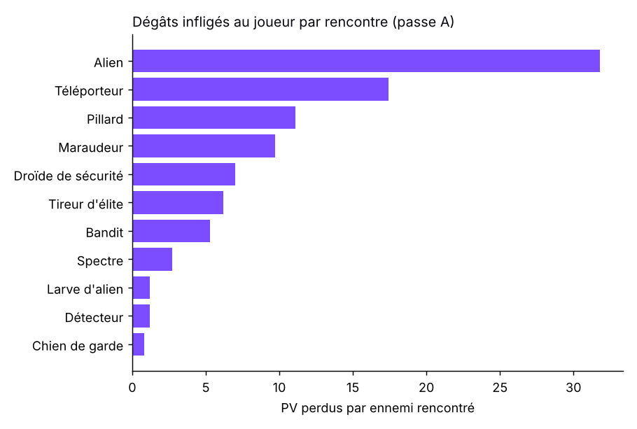

| Monstre | Vus | Tués | PV perdus par rencontre | Morts causées | TTK médian |
|---|---|---|---|---|---|
| Alien `ss_alien` | 44 | 17 | 31,8 | 6 | 20,6 s |
| Téléporteur `ss_teleporter` | 300 | 210 | 17,4 | **24** | 2,6 s |
| Pillard `fw_raider` | 184 | 102 | 11,1 | 10 | 2,7 s |
| Maraudeur `fw_marauder` | 334 | 120 | 9,7 | **21** | 5,3 s |
| Droïde de sécurité `ss_security_droid` | 319 | 213 | 7,0 | 7 | 3,4 s |
| Tireur d'élite `fw_sharpshooter` | 149 | 74 | 6,2 | 4 | 0,8 s |
| Bandit `fw_bandit` | 468 | 234 | 5,3 | 11 | 2,7 s |
| Spectre `ss_spectre` | 252 | 173 | 2,7 | 3 | 0,4 s |
| Couvée `ss_alien_brood` | 126 | 116 | 1,2 | 1 | 1,0 s |
| Détecteur `ss_detector` | 104 | 78 | 1,2 | 1 | 0,7 s |
| Chien de garde `fw_guard_dog` | 27 | 20 | 0,8 | 1 | 0,7 s |
| Robuste `fw_bruiser` | 2 | 0 | 0 | 0 | — |

Hors monstres : les zones au sol (`enemy_hazard`) ont coûté 400 PV au total, les tourelles
341 PV (1 mort), les sources non attribuées 69 PV.

Lecture :
- **Rangée 1 et rangée 2 ne respectent pas la progression de la planche.** Le Maraudeur
  (rangée 2) tue deux fois plus que le Bandit. Le Chien et le Robuste (rangée 2) sont presque
  absents des rez-de-chaussée (multiplicateur d'étage ×0,7).
- **Spectre, Détecteur et Couvée meurent en moins d'une seconde** : ce sont de la chair à canon.
- **Le TTK de l'Alien (20,6 s) est très au-dessus du reste.** Avec ses 180 PV, c'est un
  mini-tank. Il est bien placé en rangée 2, mais il mérite un télégraphe plus visible.

### Butin observé (par raid, passe A)
| Source | Commun | Peu commun | Rare | Épique | Légendaire |
|---|---|---|---|---|---|
| Cadavres | 22,95 | 4,26 | 0,14 | 0 | 0 |
| Conteneurs | 19,90 | 2,17 | 0,49 | 0,03 | 0 |
| Au sol | 16,50 | 5,51 | 0,05 | 0,08 | 0 |

4,4 conteneurs et 5,7 cadavres fouillés par raid. 5,2 soins, 2,4 équipements, 129 tirs et
55 esquives par raid.

### Passe B (avant → après l'essai)
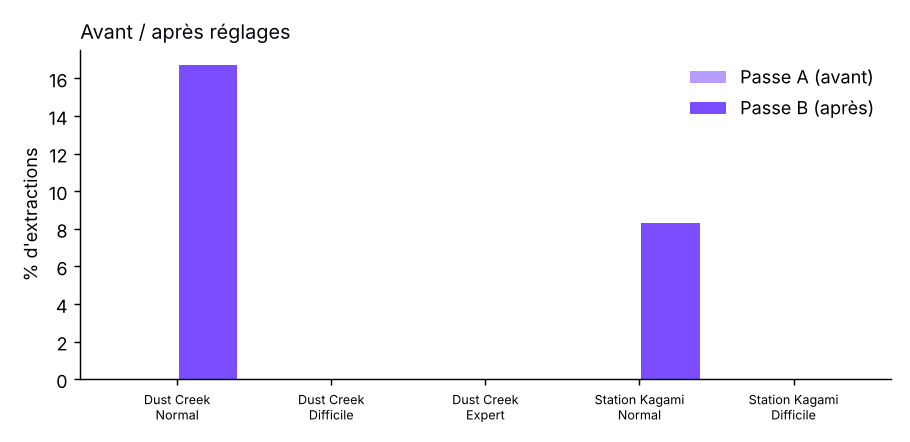

| Carte | Difficulté | Extraction A → B | Survie médiane A → B |
|---|---|---|---|
| Dust Creek | Normal | 0 % → 17 % (2/12) | 56 s → 72 s |
| Dust Creek | Difficile | 0 % → 0 % | 42 s → 42 s |
| Station Kagami | Normal | 0 % → 8 % (1/12) | 221 s → 177 s |
| Station Kagami | Difficile | 0 % → 0 % | 74 s → 70 s |

---

## Volet 2 — Boss et élites

**Protocole.** Combats lancés à l'entrée de l'arène du boss (porte de la salle, côté
extérieur), avec l'escorte et la population normale de la salle. Normal et Difficile, 3
arsenaux, 20 combats par boss. Joués sur une seconde machine (Windows, 8 cœurs, même version
du bot). Une victoire suppose la mort du boss constatée. 2 combats contre l'Omnistore sont
comptés invalides : le boss avait disparu de la liste des ennemis sans mourir (voir bugs).

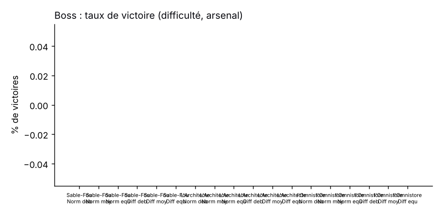

| Boss | Difficulté | Arsenal | Combats | Victoires | PV du boss au dernier coup reçu | Phase à la mort | Principal tueur |
|---|---|---|---|---|---|---|---|
| Le Shérif Sable-Fou | Normal | débutant | 3 | 0 | 100 % | 1 | Maraudeur |
| | Normal | moyen | 4 | 0 | 100 % | 1 | Shérif / Pillard |
| | Normal | bien équipé | 4 | 0 | 100 % | 1 | Pillard |
| | Difficile | débutant / moyen / bien équipé | 9 | 0 | 100 % | 1 | Maraudeur, Pillard |
| L'Architecte | Normal | débutant | 3 | 0 | 90 % | 1 | Drone tireur |
| | Normal | moyen | 4 | 0 | 84 % | 1 | Architecte |
| | Normal | bien équipé | 4 | 0 | 66 % | **2** | Architecte (laser orbital) |
| | Difficile | débutant / moyen / bien équipé | 9 | 0 | 72-90 % | 1-2 | Architecte |
| L'Omnistore | Normal | débutant / moyen / bien équipé | 9 valides | 0 | 89-93 % | 1 | Violent, Zombie |
| | Difficile | débutant / moyen / bien équipé | 9 | 0 | 88-97 % | 1 | Violent, Zombie |

Durée moyenne d'un combat de boss : 19 s.

Lecture :
- **Ce n'est pas le boss qui tue, c'est la salle.** Pour le Shérif et l'Omnistore,
  l'escorte d'élites (2) et la population de la salle (`enemy_room_mult` boss = 1,0)
  submergent le joueur avant le premier échange avec le boss.
- L'Architecte est le seul boss « jouable » : ses morts viennent de ses compétences
  télégraphiées (laser orbital), et l'arsenal fait une différence nette (66 % de PV restants
  bien équipé, 90 % en débutant).
- **Recommandation, non appliquée** : vider la salle du boss de sa population normale et ne
  garder que l'escorte (`[generator] enemy_room_mult` boss 1,0 → 0,3), et une seule élite
  d'escorte en Normal (`[boss] elite_boss_escorts` 2 → 1). Les renforts du boss en phases 2
  et 3 gardent la pression. À tester en passe dédiée.

### Élites en duel (Normal, 10 combats chacune)
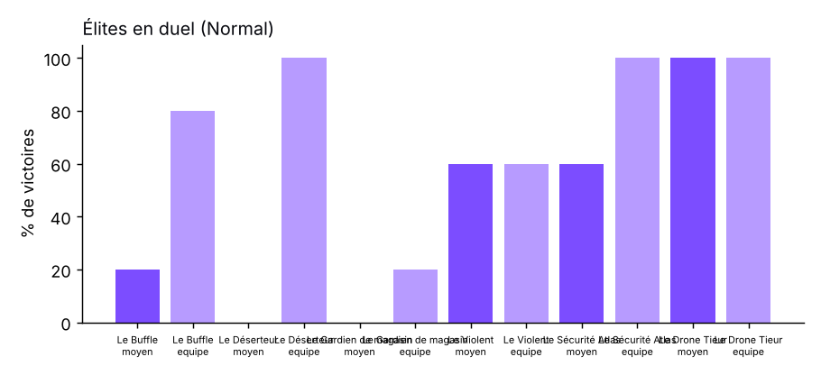

| Élite | Arsenal moyen | Bien équipé | Lecture |
|---|---|---|---|
| Le Buffle `fw_buffalo` | 1/5 (TTK 21,8 s) | 4/5 (15,2 s, 83 PV restants) | Correct |
| Le Déserteur `fw_deserter` | **0/5** | **5/5** (8,0 s) | Tout dépend de l'arsenal |
| Atlas `ss_atlas` | 3/5 (32,3 s) | 5/5 (14,7 s) | Correct |
| Drone tireur `ss_drone_tieur` | 5/5 (3,1 s, 0 dégât) | 5/5 | **Trop faible pour une élite** |
| Le Violent `mall_violent` | 3/5 | 3/5 | Correct, peu sensible à l'arsenal |
| La Gardienne `mall_store_warden` | **0/5** | **1/5** | **Trop forte** |

Recommandations, non appliquées :
- `ss_drone_tieur` : PV ×2,5, ou le sortir des élites ;
- `mall_store_warden` : dégâts −25 % ou télégraphes +30 %.

---

## Volet 3 — Taux de drop

**Protocole.** `tools/playtest/drop_sim.gd` appelle `LootRoller.roll` et
`LootManager.roll_enemy_loot` réels. Le contexte de référence (Normal, rez-de-chaussée) est
tiré 100 000 fois par source. Les autres difficultés et les étages −1 et +1 sont tirés
10 000 fois. Sources couvertes : chaque table de conteneur (salle normale et salle au
trésor), chaque cadavre d'ennemi (les élites en contexte trésor, comme en jeu) et le butin au
sol de chaque ennemi.

_(Résultats détaillés ci-dessous, section « Simulation ».)_

### Plafonds (Légendaire < 1 %, Épique < 4 % par source)
- `python3 tools/cap_drop_rates.py --check` sur `main` : **10 dépassements**, tous dans les
  tables ajoutées avec le bestiaire.
  - Buffle : diamant brut 1,46 %, carte au trésor 4,15 %. **Corrigé.**
  - Shérif : lingot d'or 32 %, Desert Eagle 32 %, SCAR-H 22 %, collier, carte et diamant
    10-13 %, P320 et AUG 2,5 %.
- **Le Shérif ne peut pas être plafonné par les poids.** Sa table tire 4 à 6 objets sans
  remise parmi une dizaine. Chaque objet rare sort donc presque à coup sûr, et l'outil de
  plafonnement ne converge pas : je n'ai rien changé. Deux options :
  1. exempter les boss du plafond et l'écrire dans `cap_drop_rates.py`. C'est ma
     recommandation : un boss vraiment très difficile doit vraiment payer ;
  2. diluer la table avec 6 à 8 objets communs (or, munitions, matériaux) pour revenir sous
     4 % et 1 %, au prix d'un boss moins gratifiant.

---

## Volet 4 — Animations, lisibilité, bugs

### Animations (`donnees/audit_animations.json`, planches ci-dessous)
- Les 28 planches de monstres ont leurs 5 animations dans les 8 directions, avec un cadavre
  en dernière image de mort.
- **Omnistore** : planches plus courtes (repos 4, course 6, mort 6 images contre 6, 8 et 8
  pour les autres). Sa mort finit sur une pose proche de la course, illisible.
- Ressemblances, distance de couleur la plus faible dans un même monde :
  - Déserteur et Shérif (0,086) : une élite qui ressemble au boss ;
  - Détecteur et Spectre (0,087) ;
  - Écorcheur et Violent (0,088) ;
  - Couvée et Détecteur ;
  - Clone et Zombie ;
  - Bandit et Déserteur.

  Côté Station, cinq robots partagent le même gris-bleu : Atlas, Droïde de sécurité, Gardien,
  Téléporteur et Architecte.
- Pieds et point d'appui : l'écart mesuré entre images (`pieds_ecart_*`) est grand pour les
  quadrupèdes (Buffle, Maraudeur, Chien, Détecteur) et pour l'Omnistore. La mesure vient de
  planches statiques et ne prouve pas une glisse en jeu : **à vérifier à l'œil** sur ces cinq-là.
- **Hauteur à l'écran** : la Couvée (58 px de planche), l'Écorcheur (76 px) et le Zombie
  (78 px) sont petits sur téléphone. L'Écorcheur est rapide et dangereux en salle de boss.

Planches (repos, course ×4, armement, coup, touché, cadavre — direction sud-est) :

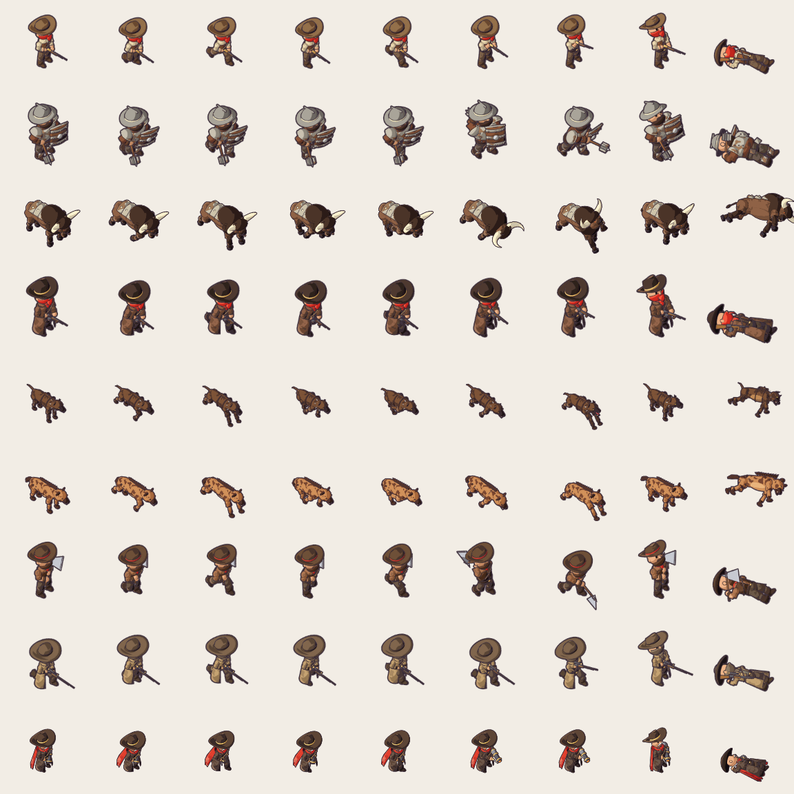
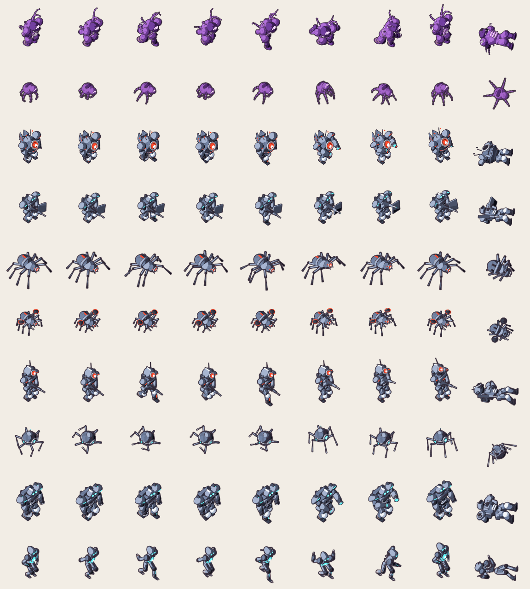
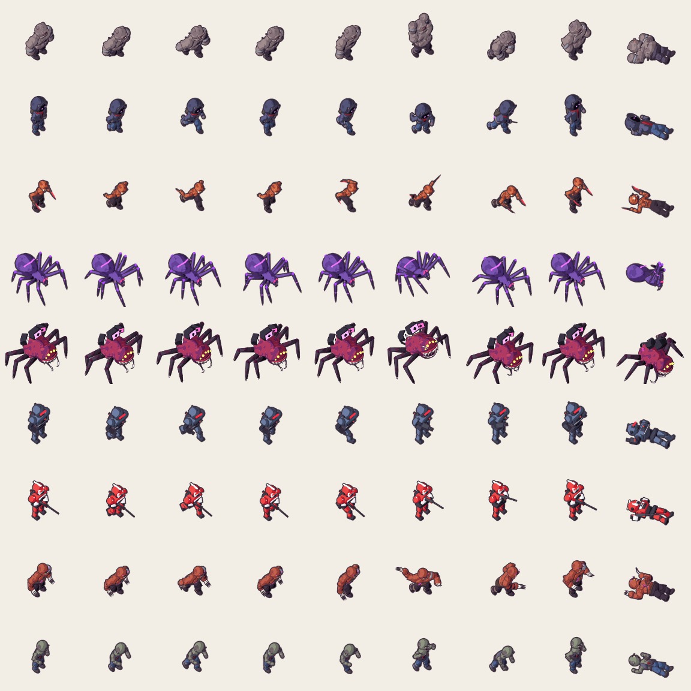

### Captures en jeu (télégraphes, phases de boss)
| | |
|---|---|
| 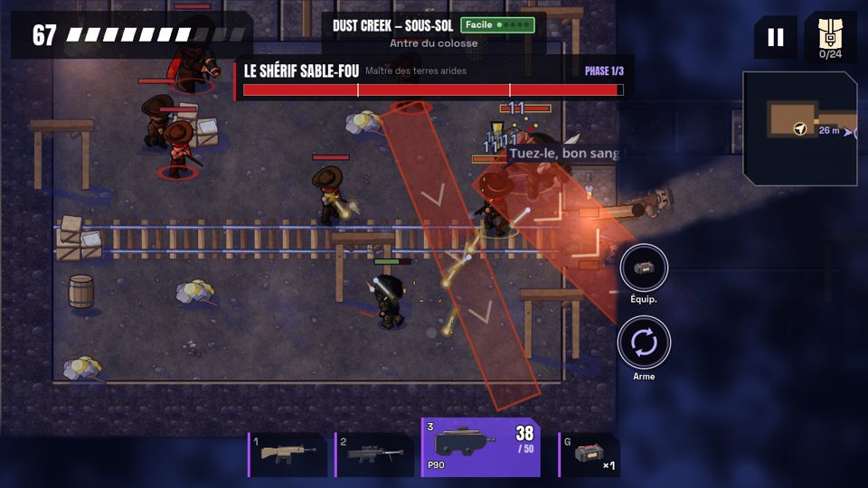 Shérif, phase 1 : couloirs rouges lisibles | 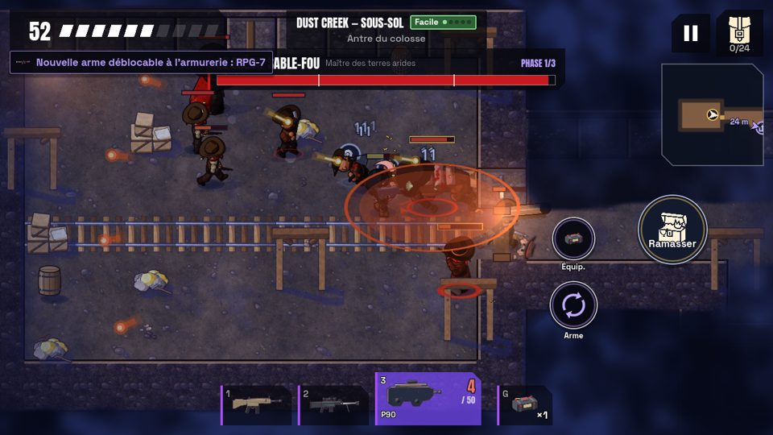 Buffle : zone de coup lisible ; message de déblocage qui chevauche la barre du boss |
| 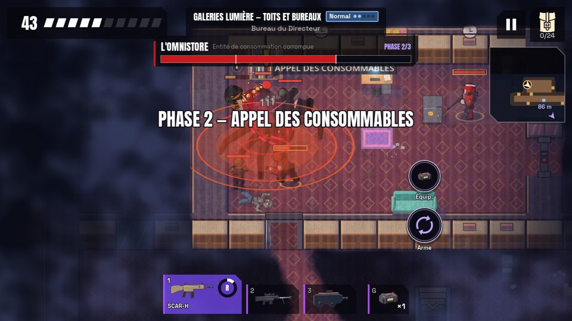 Omnistore, phase 2 « Appel des consommables » | 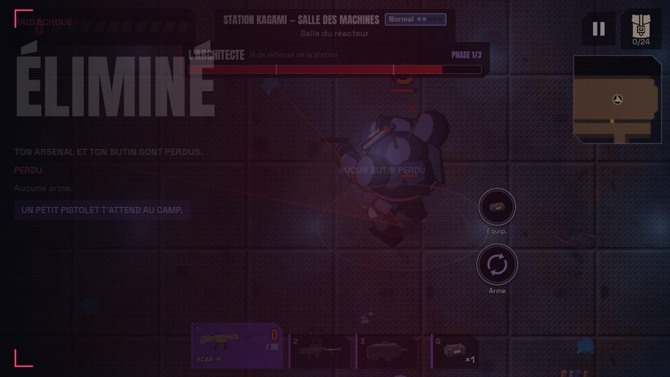 Écran « Éliminé » sous le HUD |

Autres captures dans `captures/` : télégraphes du Bandit, du Pillard, du Déserteur, de
l'Écorcheur, du Zombie, de la Gardienne, de l'Architecte et du Drone tireur.

### Bugs (seed et reproduction)
Lancement : `godot --path . --fixed-fps 60 -s res://tools/playtest/playtest_main.gd -- <options>`.

1. **L'écran de fin s'affiche sous le HUD.** `--mode=boss --map=perm_station_kagami
   --difficulty=1 --tier=equipe --seed=77` (sous xvfb). Mourir dans l'arène : la barre du
   boss, les boutons Arme/Équip., les emplacements d'armes et la mini-carte restent dessinés
   par-dessus « Éliminé ».
2. **Le message de déblocage d'arme chevauche la barre du boss.**
   `--mode=boss --map=perm_dust_creek --difficulty=1 --tier=equipe --seed=77`. Tuer le 3e
   Pillard près du Shérif : « Nouvelle arme débloquable : RPG-7 » recouvre le titre
   « Le Shérif Sable-Fou ».
3. **Les répliques des ennemis se superposent aux sprites** (« Tuez-le, bon sang », même
   lancement que le bug 2). La bulle passe sous les numéros de dégâts et coupe le texte.
4. **L'Omnistore disparaît de la liste des ennemis vivants sans mourir.** Seeds 9042 et 9044,
   `--mode=boss --map=perm_galeries_lumiere --difficulty=1 --tier=debutant|moyen`.
   `Raid.get_alive_enemies()` ne le renvoie plus, alors qu'il garde 79 à 94 % de ses PV.
   Probablement pendant une illusion ou un changement de phase. À vérifier côté
   `mall_omnistore_illusion`.
5. **Ennemis bloqués** (alertés, immobiles 5 s en voulant bouger), 16 cas en 150 raids, par
   exemple :
   - seed 1031 Dust Creek Facile agressif (2 Maraudeurs) ;
   - seed 5023 Kagami Difficile fouilleur (Détecteur + Droïde) ;
   - seed 1022 Kagami Difficile agressif (Spectre).
6. **Pic de 438 ms** sur une image : seed 5030, Kagami Normal, profil prudent.
7. **Un raid n'est pas rejouable à l'identique** avec la même seed : l'IA ennemie et la
   physique ne sont pas déterministes (seed 1005 : une mort à 20 s, puis une extraction à 47 s).
   Cela gêne la reproduction des bugs ; à garder en tête pour les tests.

### Autres remarques (non codées)
- Le bandeau du raid affiche la difficulté de la carte. C'est juste en jeu, mais trompeur
  dans les outils qui forcent une autre difficulté.
- Le bot n'a jamais atteint un étage inférieur en raid : il meurt avant d'avoir exploré le
  rez-de-chaussée. Les élites et les boss ne sont donc rencontrés qu'en volet 2.
- Idée : un **indicateur de meute** (icône sur la mini-carte quand 3 Maraudeurs ou plus
  approchent). Le joueur ne peut pas les semer, il doit au moins les voir venir.

---

## Limites et méthode
- Bot : `tools/playtest/README.md` (comportement, profils, journaux). Aucune triche.
  L'accélération vient de `--fixed-fps 60` sans limite d'images, pas de `Engine.time_scale`,
  pour ne pas changer le pas de la physique.
- Deux machines : ce conteneur (4 cœurs, 2 parties en parallèle) pour les passes A et B, les
  drops, les animations et les captures ; une tour Windows (8 cœurs, 4 en parallèle) pour les
  boss et les duels.
- Incidents de la nuit :
  - une première passe A a été jetée après un blocage du bot à la mort (le jeu se met en
    pause), corrigé dans `2b388db` ;
  - 2 parties de la passe B (seeds 5002 et 5003) ont été rejouées : elles avaient démarré
    pendant 9 s sans les réglages de l'essai, à la suite d'une erreur de manipulation.
- Fichiers : `donnees/parties_*.csv` (une ligne par partie), `donnees/resume.json`
  (agrégats), `donnees/audit_animations.json`, `donnees/essai_passe_B.patch`. Les journaux
  bruts des boss et des duels sont sur la branche `playtest-runs`.
